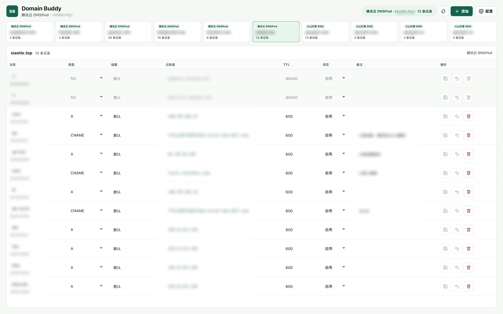

# Domain Buddy

Domain Buddy 是一个本地运行的跨平台 DNS 管理桌面应用。它把多个云厂商的域名与解析记录集中到一个界面中，适合同时使用多家 DNS 服务、又不想频繁切换控制台的个人开发者和小团队。

> 当前版本为 `0.1.0`，仍处于早期阶段。修改或删除记录会直接调用云厂商 API，请先在非关键域名上验证，并为凭证配置最小权限。

## 能做什么

- 保存并验证多个 DNS 供应商配置。
- 聚合展示所有已配置账号中的域名。
- 查看域名解析记录及状态、TTL、线路、备注等信息。
- 新增、修改、删除解析记录；DNSPod、阿里云与火山引擎还支持启用或停用记录。
- 在编辑记录值时复用当前域名已有的记录值。
- 在本机完成请求签名和 API 调用，不依赖 Domain Buddy 自有服务器。

## 供应商支持

| 供应商 | 域名同步 | 记录查询 | 新增 / 修改 / 删除 | 备注 | 状态 |
| --- | --- | --- | --- | --- | --- |
| 腾讯云 DNSPod | 支持 | 支持 | 支持 | 支持 | 已支持 |
| Cloudflare | 支持 | 支持 | 支持 | 支持 | 已支持 |
| 火山引擎 DNS | 支持 | 支持 | 支持 | 支持 | 已支持 |
| 阿里云 DNS | 支持 | 支持 | 支持 | 支持 | 已支持 |

## 界面预览



截图中的账号、域名和解析记录等敏感信息均已模糊处理。

## 安全设计

- SecretKey、API Token 等敏感凭证保存在操作系统凭证库中，不写入项目目录或普通配置文件。
- 应用配置文件只保存供应商、区域等非敏感信息；旧版本的本地明文凭证会在迁移成功后从配置文件中移除。
- 前端只接收“凭证已保存”等状态，不读取已保存的完整密钥。
- DNS 请求仅允许发送到各供应商的官方 HTTPS Endpoint。
- 项目没有遥测、云端同步或 Domain Buddy 中转服务；DNS 请求由桌面端直接发往供应商 API。

操作系统凭证库只能降低明文文件泄露风险，不能替代系统账号安全。请锁定系统会话、及时安装安全更新，并且不要共享应用数据目录。

### 最小权限建议

- 为 Domain Buddy 创建独立凭证，不复用主账号管理员密钥。
- Cloudflare Token 建议仅授予目标 Zone 的 `Zone:Read` 与 `DNS:Edit`。
- DNSPod、阿里云和火山引擎凭证只授予列出域名、读取和编辑 DNS 记录所需权限，并尽可能限制到指定域名或项目。
- 不要授予账户管理、账单、用户管理或其他无关权限。
- 不再使用应用时，及时在云厂商控制台撤销对应凭证。

发现安全问题时，请不要创建公开 Issue，参见 [SECURITY.md](SECURITY.md)。

## 环境要求

- Node.js 22（最低需满足 Vite 7 的 Node.js 版本要求）
- npm 10 或更高版本
- Rust stable 工具链
- Tauri 2 对应的系统依赖

macOS、Windows 和 Linux 的系统依赖不同，请先完成 [Tauri 2 prerequisites](https://v2.tauri.app/start/prerequisites/) 中对应平台的安装。

## 本地开发

```bash
git clone https://github.com/Leochens/domain-buddy.git
cd domain-buddy
npm ci
npm run tauri dev
```

浏览器中的 Vite 页面无法直接调用 Tauri 命令；完整功能需要通过 `npm run tauri dev` 启动桌面窗口。

开发版需要与日常配置隔离时，可先创建权限收紧的临时目录，再通过 `DOMAIN_BUDDY_CONFIG_DIR` 指定它：

```bash
DOMAIN_BUDDY_TEST_DIR="$(mktemp -d)"
DOMAIN_BUDDY_CONFIG_DIR="$DOMAIN_BUDDY_TEST_DIR" npm run tauri dev
```

该变量仅在开发构建中生效，并同时隔离配置元数据和系统凭证库槽位。目录必须是 `mktemp -d` 创建的绝对路径；不要提交该目录，也不要指向真实配置。

## 构建与检查

构建前端：

```bash
npm run build
```

运行前端构建、Rust 格式检查、编译检查和测试：

```bash
npm run check
```

构建桌面安装包：

```bash
npm run tauri build
```

安装包默认生成在 `src-tauri/target/release/bundle/`。具体格式取决于当前操作系统；项目暂未提供代码签名、公证或自动发布流程。

## 使用方法

1. 在对应云厂商创建一组最小权限凭证。
2. 启动 Domain Buddy，在供应商配置中填写凭证并保存。
3. 验证配置，确认应用能够读取域名列表。
4. 选择域名后查看解析记录。
5. 新增、修改或删除记录，并到云厂商控制台或使用 DNS 查询工具复核结果。

DNS 解析存在缓存和传播时间。界面显示 API 操作成功，不代表所有递归 DNS 服务器会立即返回新结果。

## 已知限制

- 当前没有批量修改、导入导出、操作审计和自动回滚功能。
- DNSPod、Cloudflare、阿里云和火山引擎都会按供应商分页信息继续拉取；若服务端提前结束或返回自相矛盾的分页元数据，应用会明确报错而不是静默截断。
- 暂未提供官方预编译安装包，也未完成 macOS / Windows 代码签名。
- 真实云账号能力需要使用者自行验证；仓库中的构建检查不会对真实 DNS 执行增删改操作。

## 项目结构

```text
domain-buddy/
├── src/                    # React 界面
├── src-tauri/src/          # Tauri 命令、凭证管理和供应商适配
├── src-tauri/icons/        # 桌面应用图标
├── assets/                 # 设计源文件
└── .github/                # CI 与协作模板
```

## 参与贡献

欢迎提交 Bug、功能建议和 Pull Request。开始前请阅读 [CONTRIBUTING.md](CONTRIBUTING.md) 与 [CODE_OF_CONDUCT.md](CODE_OF_CONDUCT.md)。新增供应商时，请保持供应商 API 适配与界面逻辑分离，并且不要提交真实凭证或域名数据。

## 许可证

Domain Buddy 使用 [MIT License](LICENSE) 开源。
