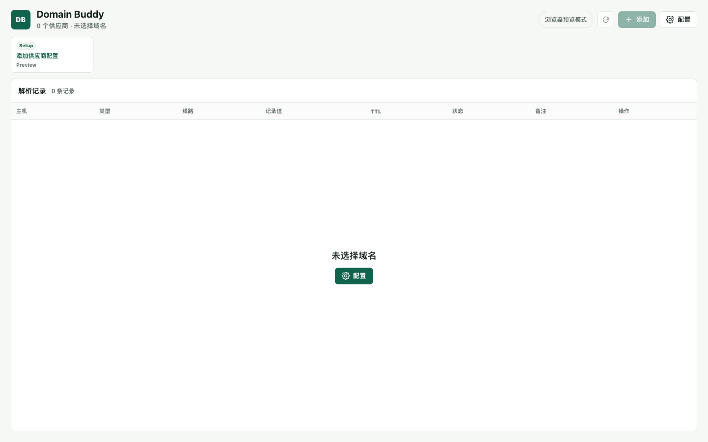

# linux.do 发布稿

## 标题

[开源] Domain Buddy：把 DNSPod、Cloudflare 和火山引擎 DNS 放进一个桌面应用

## 正文

大家好，我把自己日常管理域名时用的小工具 **Domain Buddy** 开源了。

我同时在用几家 DNS 服务，每次查看或修改解析记录，都要在不同控制台之间来回切换。Domain Buddy 就是为了解决这个问题：它是一个基于 Tauri 2 + React 的本地桌面应用，把多个供应商的域名和 DNS 记录集中到同一个界面里管理。

目前支持：

- 腾讯云 DNSPod、Cloudflare、火山引擎 DNS；
- 多账号配置与凭证验证；
- 聚合查看域名和解析记录；
- 新增、修改、删除记录；
- 记录备注，以及 DNSPod / 火山引擎的启用、停用；
- 完整分页拉取，数据量较大时不会只显示前几页。

安全方面，API Token、SecretKey 等敏感信息保存在操作系统凭证库，不会写入普通配置文件；请求由桌面端直接发往供应商官方 HTTPS API，项目没有中转服务、遥测或云端同步。

项目目前还是早期版本：阿里云入口只做了预留，尚未接入；也暂时没有官方签名的安装包，需要按 README 从源码运行或构建。修改 DNS 会直接调用供应商 API，建议使用最小权限凭证，并先在非关键域名上验证。

仓库地址：<https://github.com/Leochens/domain-buddy>

如果这个工具对你有帮助，欢迎点个 Star。遇到 Bug、希望接入其他 DNS 服务，或者对交互有建议，也欢迎提 Issue / PR。谢谢大家！
